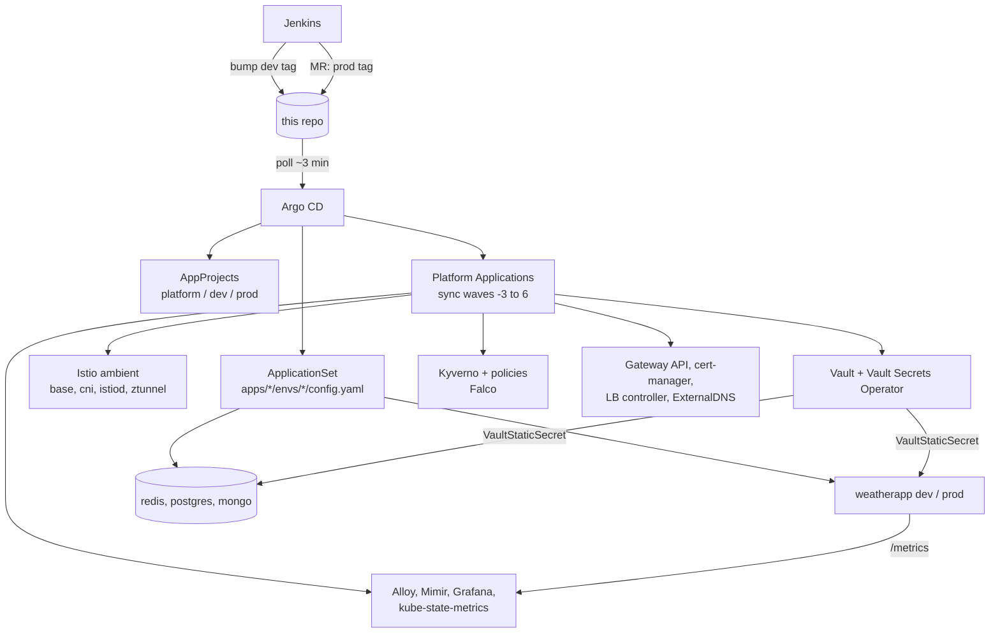

# eks-platform-gitops

Argo CD app-of-apps repository for a single EKS cluster. One root Application renders AppProjects, an ApplicationSet for workloads, and
explicit platform Applications ordered by sync wave: Istio ambient, Vault with Vault Secrets Operator, Kyverno, Falco, cert-manager,
Gateway API, and a Mimir, Alloy and Grafana monitoring stack. The cluster is provisioned by
[eks-platform-infra](https://github.com/manoVaturi/eks-platform-infra); the application image is built from
[weather-service](https://github.com/manoVaturi/weather-service).

## Architecture



### Sync and request lifecycle

1. `bootstrap/root-app.yaml` is applied once. It points Argo CD at `argocd/`.
2. AppProjects sync first (wave -10), then ApplicationSets (-5, -4), then platform Applications by wave: Istio (-3 to 0), Vault (1 to 4), Kyverno (1 to 2), monitoring (3 to 6).
3. The ApplicationSet reads `apps/<app>/envs/<env>/config.yaml` and generates one Application per environment, each bound to the `dev` or `prod` AppProject.
4. Vault Secrets Operator reads `kv/*` from Vault and writes Kubernetes Secrets into the namespaces allowed by the `vso` role.
5. Traffic arrives through a Gateway API gateway, enters the Istio ambient mesh, and reaches the weatherapp pods. Alloy scrapes the pods and pushes to Mimir; Grafana reads from Mimir.

## Key decisions

| Decision | Reason |
| --- | --- |
| Platform Applications are explicit files, workloads are generated | Sync waves only order resources the root app manages directly; they are not honoured for Applications generated by an ApplicationSet. |
| Prod image tag changes only by merge request | CI writes to dev automatically; a release tag opens a reviewed merge request against `apps/weatherapp/envs/prod/values.yaml`. |
| Istio ambient instead of sidecars | mTLS and L4 policy with a per-node ztunnel; less memory on a one-node cluster. |
| Vault Secrets Operator over External Secrets | Secret values stay in Vault on a KMS-unsealed persistent volume; Git holds only `VaultStaticSecret` references. |
| In-house charts for small components (`database`, `mimir`, `gateway`, `netpol`) | Upstream charts either lacked a single-process mode (Mimir) or were heavier than the need. |
| Kyverno in `Audit` mode | Policy reports are reviewed before enforcement is turned on. |

## Layout

```text
.
├── bootstrap/
│   ├── root-app.yaml               app-of-apps entry point, applied once
│   └── argocd-values.yaml          Argo CD Helm values
├── argocd/
│   ├── projects/                   AppProjects: platform, dev, prod
│   ├── applicationsets/workloads.yaml
│   ├── platform/<group>/<name>.yaml   istio, vault, kyverno, system, monitoring
│   └── workloads/                  resources outside the generated apps
├── platform/<group>/<name>/values.yaml   Helm values per platform Application
├── apps/<app>/envs/<env>/          config.yaml and values.yaml per workload and environment
├── charts/                         in-house charts: weatherapp, database, mimir, gateway, netpol,
│                                   cert-issuers, vault-secrets, vault-storage, vpa-targets, grafana-dashboards
├── docs/karpenter.md               design guide for node autoscaling (not deployed)
└── scripts/                        validate.sh, check_configs.py
```

## Bootstrap

Prerequisite: the cluster and Vault from eks-platform-infra (see its `docs/runbook.md`). Replace the placeholders below with values from
`terragrunt output` and AWS before the first sync:

| Placeholder | File |
| --- | --- |
| `<AWS_ACCOUNT_ID>` | `charts/weatherapp/values.yaml`, `charts/gateway/values.yaml`, `platform/vault/vault/values.yaml` |
| `<CERT_ID>`, `<WEB_ACL_ID>` | `charts/gateway/values.yaml` |
| `<KMS_KEY_ID>` | `platform/vault/vault/values.yaml` |
| `<VPC_ID>` | `platform/system/aws-load-balancer-controller/values.yaml` |
| `<VAULT_VOLUME_ID>` | `platform/vault/vault-storage/values.yaml` |

```bash
helm upgrade --install argocd argo/argo-cd --version 10.10.5 -n argocd --create-namespace \
  -f bootstrap/argocd-values.yaml
kubectl apply -f bootstrap/root-app.yaml
kubectl -n argocd get applications
```

Add a workload by creating `apps/<app>/envs/<env>/config.yaml`:

```yaml
name: weatherapp-staging   # Application name
app: weatherapp            # folder under apps/
env: dev                   # AppProject: dev | prod
namespace: weatherapp-dev  # must be allowed by the project
chart: weatherapp          # folder under charts/
mesh: ambient              # ambient | none
```

## Verification

```bash
scripts/validate.sh                      # yamllint, config cross-checks, helm lint, kubeconform
kubectl -n argocd get applications       # Synced and Healthy
kubectl get vaultstaticsecret -A         # SYNCED True
kubectl -n argocd port-forward svc/argocd-server 8080:443
kubectl -n monitoring port-forward svc/grafana 3000:80
```

Dashboards are provisioned from `charts/grafana-dashboards/dashboards/`; alert rules from `platform/monitoring/grafana/values.yaml`.

## Known constraints

- Dev and prod use the same database instances; separate them or at least the database names and credentials for real isolation.
- Kyverno runs in Audit mode; switch policies to Enforce after the reports are clean.
- Mimir and Grafana have no persistent storage (24 h retention); production needs an S3 backend and Alertmanager.
- The cluster is a single Spot node. Karpenter and multi-AZ node groups are described in `docs/karpenter.md` but not deployed.
